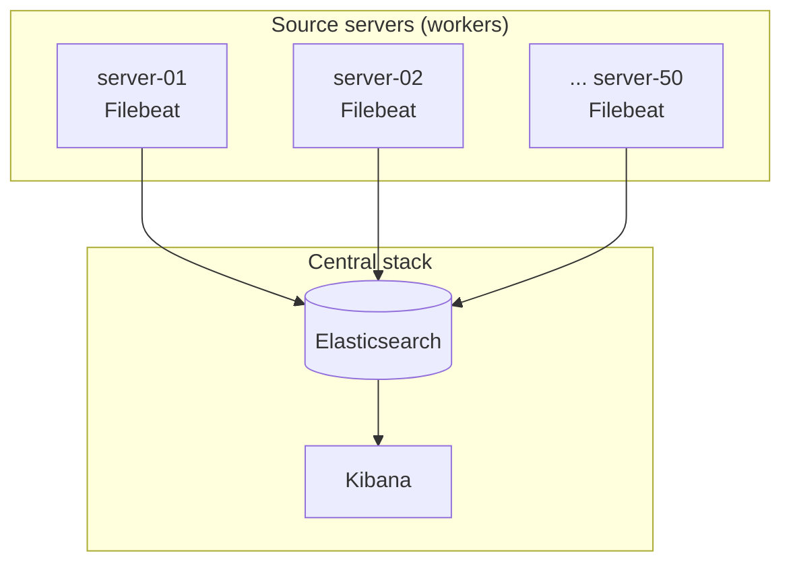

# 01. What is the ELK Stack?

## 🎯 The core idea

> **ELK Stack = a system that collects logs from all your servers into one place, so you can search, visualize, and get alerted from a single screen.**

**Analogy:** a building with 50 rooms. Without ELK you walk into each room to check if something is wrong. With ELK you have a **security control room** with one wall of screens showing every room.

---

## 😖 The problem it solves

Imagine you run **50 servers** (your own, or your clients').

| Without central logging | With ELK |
|---|---|
| SSH into each server, `grep` through files | Open one browser tab, type one search |
| Logs are lost when a server dies or is rebuilt | Logs are safe in the central cluster |
| Cannot see patterns across servers | "Show errors from all 50 servers in the last 15 minutes" |
| Find out about problems from angry users | Alert fires before users notice |
| No audit trail | Searchable history for compliance |

---

## 🧱 What "ELK" actually means

| Letter | Tool | Role in one line |
|--------|------|------------------|
| **E** | Elasticsearch | Stores and searches the data (the engine) |
| **L** | Logstash | Cleans and transforms data (the filter) |
| **K** | Kibana | Web UI for search and dashboards (the face) |
| + | **Beats** (Filebeat, Metricbeat...) | Small agents on each server that ship data (the couriers) |

- **ELK** was the original name. Once Beats were added, the official name became the **Elastic Stack**.
- **Elastic Agent + Fleet** is the newer all-in-one agent that can replace several Beats and is managed centrally from Kibana. Beats are still fully supported and are the best way to learn the fundamentals.

> [!NOTE]
> Beats, Logstash, and Elastic Agent are all "ingest" tools. In modern setups Logstash is **optional**; many teams go straight from Beats/Agent to Elasticsearch.

---

## 🖥️ Worker servers vs central server

"Worker" and "central" are not official Elastic terms, but they are a great way to think about it.

| Role | Also called | What runs there | How many |
|------|-------------|-----------------|----------|
| **Source server** | worker, monitored host, edge | Your app + a light **Beat/Agent** | As many as you have (50, 500...) |
| **Central stack** | monitoring server, log platform | Elasticsearch + Kibana (+ Logstash) | 1 for a lab, **3+ for production** |

**Key rule:** the source servers do almost nothing (just read and send). The central stack does all the heavy work (storing, indexing, searching), so it needs the strong hardware.

---

## 🏭 Real production use cases

1. **Troubleshooting:** "Why did checkout fail at 3:12 AM?" Search by time, server, error text.
2. **Security and audit:** failed SSH logins, `sudo` usage, firewall hits across all servers.
3. **Uptime and performance:** slow requests, 5xx error rate, CPU/memory trends (Metricbeat).
4. **Business analytics:** orders per minute, top endpoints, traffic by country (from access logs).
5. **Compliance:** keep logs for 90 days / 1 year with proof they were not tampered with.
6. **Alerting:** notify Slack / email / Telegram when error rate spikes.

---

## 🚫 What ELK is NOT

- ❌ **Not your main application database.** Elasticsearch is a search and analytics engine. It is not built for strict transactions (ACID) like PostgreSQL or MySQL.
- ❌ **Not free to run.** The software can be free, but servers, disk, and people to run it cost real money (see [07](07-pros-cons-and-pitfalls.md)).
- ❌ **Not "install and forget".** It needs sizing, retention rules, backups, and upgrades.

---

## ➡️ Next

[02. How it works](02-how-it-works.md)
