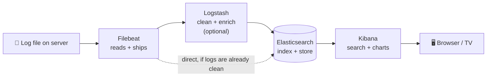
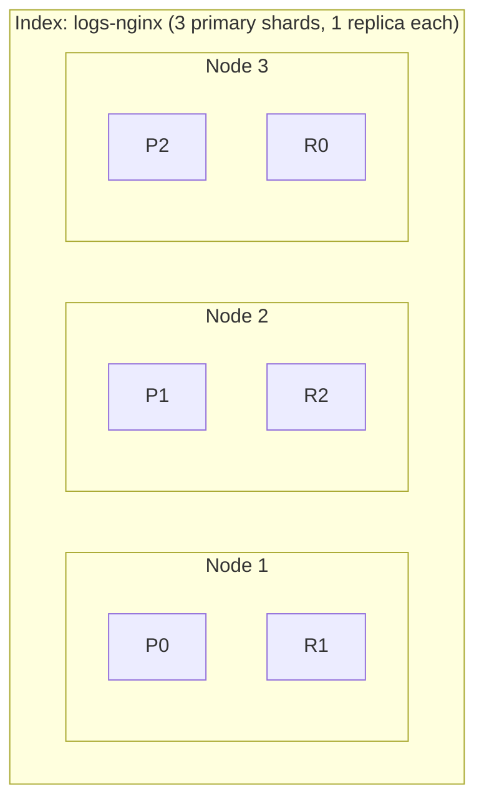
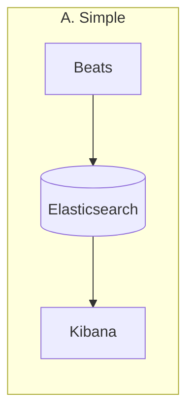
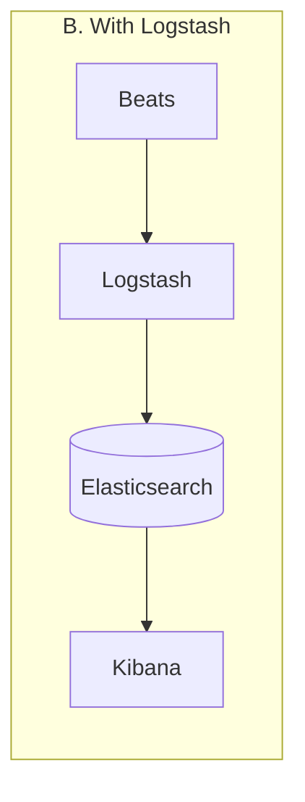
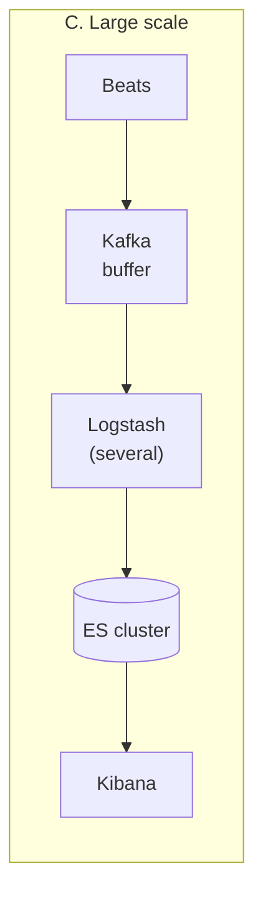

# 02. How the ELK Stack Works

## 🔄 The data journey



| Step | Who | What happens |
|------|-----|--------------|
| 1 | **Beats** | Watches log files 24/7, sends new lines as JSON events |
| 2 | **Logstash** *(optional)* | Parses, cleans, enriches, routes |
| 3 | **Elasticsearch** | Indexes and stores; answers searches fast |
| 4 | **Kibana** | Queries Elasticsearch and draws the UI |

---

## 1️⃣ Beats: the couriers

**Core idea:** tiny, lightweight programs installed on each server. They watch something and send what they see.

**How Filebeat works:** it remembers *how far it has read* in each file (a "registry"). When new lines appear, it reads only the new part, wraps each line in a JSON event with metadata (hostname, file path, timestamp), and sends it. If the network or the central server is down, it **retries and resumes from where it stopped**, so no logs are lost.

| Beat | Collects | Typical use |
|------|----------|-------------|
| **Filebeat** | Log files | App logs, Nginx, syslog, auth logs |
| **Metricbeat** | System/service metrics | CPU, RAM, disk, Docker, Nginx stats |
| **Winlogbeat** | Windows Event Logs | Windows servers |
| **Auditbeat** | Audit/security events | File changes, logins, processes |
| **Heartbeat** | Uptime checks | Is this URL / port up? |
| **Packetbeat** | Network traffic | Network-level analysis |

> [!IMPORTANT]
> **Correction to a common belief:** Filebeat does *not* magically turn every log line into neat fields. It ships each line as JSON, but the actual text is usually still one big `message` field. The **parsing** into fields (`status_code`, `client_ip`...) is done by:
> - **Filebeat modules** (ready-made parsers for Nginx, Apache, MySQL, system logs...), or
> - **Elasticsearch ingest pipelines**, or
> - **Logstash** filters.

---

## 2️⃣ Logstash: the cleaning station

**Core idea:** a pipeline with three stages: **input → filter → output**.

```text
input  { beats { port => 5044 } }        # receive
filter { grok / date / mutate / geoip }  # clean, parse, enrich
output { elasticsearch { ... } }         # send
```

What the filter stage does:

| Filter | Job | Example |
|--------|-----|---------|
| `grok` | Cut a text line into fields | `ERROR payment Timeout` → `level`, `service`, `msg` |
| `date` | Use the log's own time as `@timestamp` | Fix wrong timestamps |
| `mutate` | Rename, remove, convert fields | Drop passwords, convert to number |
| `geoip` | IP → country/city | Map of visitors |
| `drop` | Throw away noise | Health-check spam |

### When do you need Logstash?

| Situation | Need Logstash? |
|-----------|----------------|
| Standard logs (Nginx, syslog) with Filebeat modules | ❌ No |
| Simple parsing | ❌ No (use ingest pipelines) |
| Complex custom parsing, many sources, enrichment | ✅ Yes |
| Send the same data to several destinations | ✅ Yes |
| Need a buffer so spikes do not hurt Elasticsearch | ✅ Yes (persistent queue) or Kafka |
| Mask sensitive data (PII, tokens) centrally | ✅ Yes |

> [!TIP]
> Logstash is heavy (JVM, 1 GB+ RAM). **Start without it.** Add it when you have a real reason.

---

## 3️⃣ Elasticsearch: the engine

**Core idea:** a distributed **search and analytics engine** built on Apache Lucene. It is not "a faster normal database"; it is a *different kind of tool* designed to answer "find these words, in this time range, grouped by this field" across billions of records in milliseconds.

### Why is it fast? The inverted index

**Analogy:** the index at the back of a book. To find "payment", you do not read every page; you look up the word and get the page numbers.

Three log lines:

| Doc ID | Text |
|--------|------|
| 1 | `payment timeout error` |
| 2 | `login success` |
| 3 | `payment error database` |

Elasticsearch builds this **inverted index** (word → documents):

| Term | Found in docs |
|------|---------------|
| payment | 1, 3 |
| timeout | 1 |
| error | 1, 3 |
| login | 2 |
| success | 2 |
| database | 3 |

Search `payment AND timeout` → docs {1,3} ∩ {1} = **doc 1**. No scanning of all data, just a lookup and a set intersection. That is why it scales.

### Sharding: how big data stays fast

An **index** is split into **primary shards**. Each shard is a complete mini search engine. Shards are spread over nodes, and each can be searched **in parallel**.



| Concept | Meaning |
|---------|---------|
| **Primary shard (P)** | Holds a slice of the data |
| **Replica shard (R)** | A copy on a *different* node: survives node failure and speeds up reads |
| **Parallel search** | Every shard searches its part at the same time; results are merged |

> [!WARNING]
> The number of **primary shards is fixed when an index is created** (it can only be changed with split/shrink or reindex). Too many tiny shards is one of the most common production mistakes. See [06](06-production-best-practices.md).

### Other facts worth knowing

- **Near real-time:** a new document becomes searchable in about **1 second** (the refresh interval), not instantly.
- **Cluster health colors:** 🟢 green = all shards assigned · 🟡 yellow = replicas missing (normal on a single node) · 🔴 red = some primary data unavailable.
- **Node roles:** `master` (cluster brain), `data` (stores shards; can be split into hot/warm/cold), `ingest` (pre-process documents), `coordinating-only` (route requests).
- **Data streams:** the modern way to store append-only time-series data like logs. You write to one name (`logs-nginx-prod`), and Elasticsearch creates and rolls over hidden backing indices automatically.
- **Mappings:** the schema (field → type). Dynamic mapping guesses types; in production you control it with **index templates**.

---

## 4️⃣ Kibana: the face

**Core idea:** a web app (default port **5601**) that talks to Elasticsearch's REST API. You never store logs in Kibana; it only **asks** and **draws**.

| Feature | Use |
|---------|-----|
| **Discover** | Search and filter raw logs (like Google for your logs) |
| **Lens / Visualize** | Bar, line, pie, metric, map, table |
| **Dashboards** | Combine many charts on one screen (great for a TV) |
| **Alerting (Rules)** | Notify when a condition is met |
| **Dev Tools** | Run raw Elasticsearch queries |
| **Stack Management** | Data views, ILM, users, roles, API keys |
| **Spaces** | Separate workspaces per team (Dev, Ops, Security) |

---

## 🏗️ Three common architectures







| | A. Simple | B. Logstash | C. Kafka buffer |
|---|---|---|---|
| Best for | Learning, small/medium | Custom parsing, enrichment | High volume, cannot lose data |
| Complexity | Low | Medium | High |
| Survives Elasticsearch outage? | Beats retry | Queue helps | ✅ Kafka holds data |

---

## 🧾 Quick fixes to common misunderstandings

| Common belief | Reality |
|---------------|---------|
| "Beats sends clean structured JSON" | It sends JSON events, but parsing into fields needs modules / ingest pipelines / Logstash |
| "Logstash is always required" | Often not; it is optional |
| "Elasticsearch is a faster database" | It is a search/analytics engine; do not use it as your primary transactional DB |
| "Install Java first" | Not needed; Elasticsearch and Logstash **bundle their own JDK** |
| "Data is searchable instantly" | Near real-time (~1s refresh) |

➡️ Next: [03. Single-server setup](03-single-server-setup.md)
