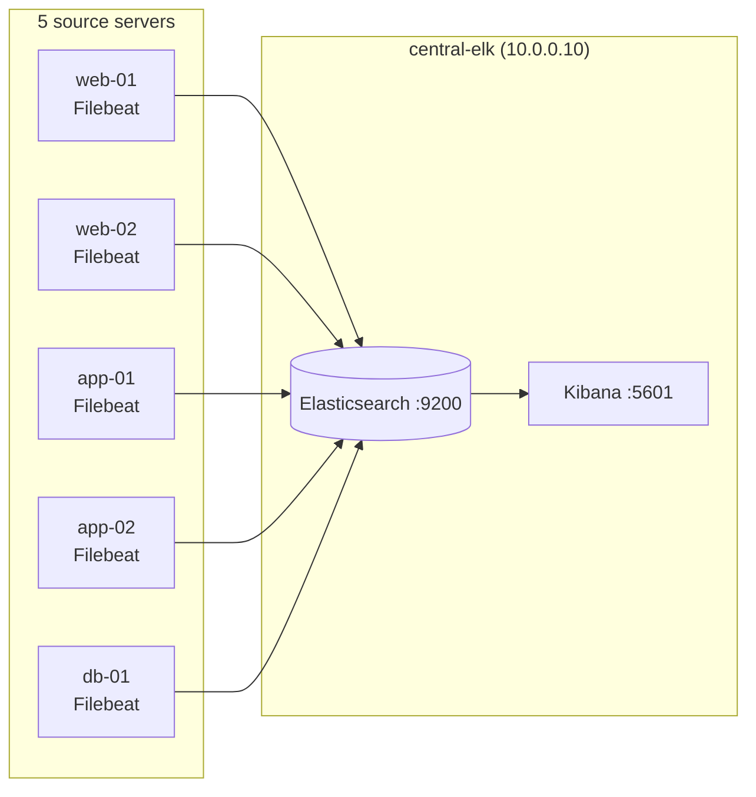
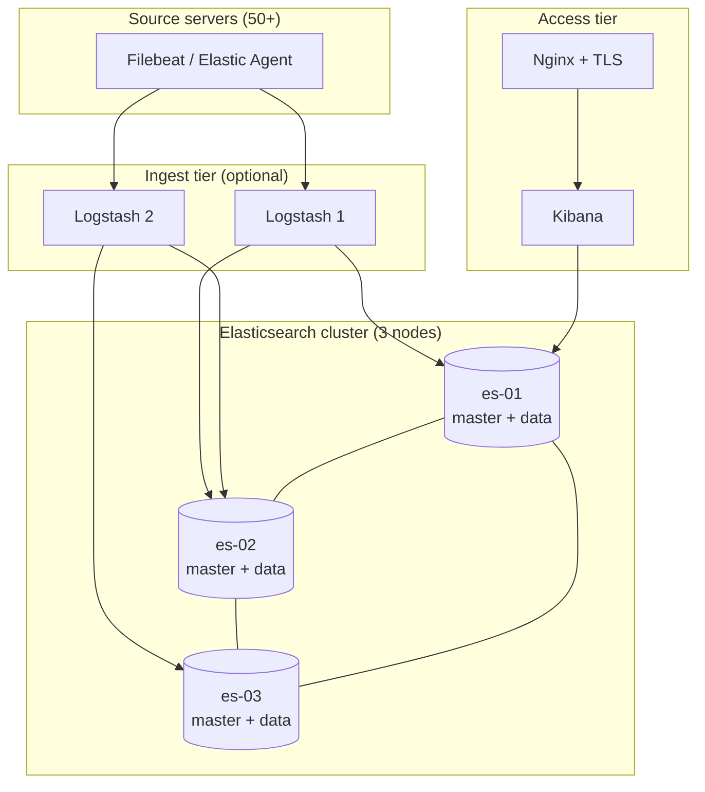

# 05. Multi-Server Setup (Production Style)

Two real-world questions answered here:

1. **"I have 5 servers. How do I send all their logs to one central place?"** → Part A
2. **"How do I make the central stack itself reliable?"** → Part B

---

## ❓ Can I choose any server as "central"?

Yes, there is no special "central" mode. Any server can be the central stack if it meets these rules:

| Requirement | Why |
|-------------|-----|
| **Enough RAM / CPU / fast disk** | It does all indexing and searching |
| **Reachable from every source server** (private network / VPN) | Beats must connect to it |
| **Stable IP or DNS name** (e.g., `elk.internal.example.com`) | Agents are configured with it |
| **Accurate time (NTP)** on all servers | Wrong clocks = logs in the wrong place on the timeline |
| **Not one of your critical app servers** | Heavy load hurts your app, and if that server dies you lose the apps *and* the logs that explain why |
| **Firewall: only required ports from required sources** | Security |

> [!IMPORTANT]
> **Best practice:** a dedicated central server (or cluster) that runs **only** the Elastic Stack. Never use your busiest production server as the log server.

---

## 🅰️ Part A: 5 source servers → 1 central server



### A1. Build the central server

Follow [03](03-single-server-setup.md) Steps 1-4, with **one change** in `elasticsearch.yml`: listen on the **private IP**, not localhost, so other servers can connect:

```yaml
cluster.name: prod-logs
node.name: central-elk
network.host: 10.0.0.10        # private IP of the central server
http.port: 9200
```

Restart and re-test:

```bash
sudo systemctl restart elasticsearch
sudo curl --cacert /etc/elasticsearch/certs/http_ca.crt -u elastic https://10.0.0.10:9200
```

> [!NOTE]
> The auto-generated HTTP certificate is made for the install-time host. If clients complain about a hostname mismatch, create a certificate that includes the DNS name / IP agents use (see "TLS certificates" below), or connect using the name in the certificate.

### A2. Firewall on the central server

Allow **only your private network** (replace `10.0.0.0/24`):

```bash
sudo ufw allow OpenSSH
sudo ufw allow from 10.0.0.0/24 to any port 9200 proto tcp    # Beats -> Elasticsearch
# sudo ufw allow from 10.0.0.0/24 to any port 5044 proto tcp  # only if you use Logstash
sudo ufw enable
```

Kibana stays on `127.0.0.1`, exposed via Nginx + HTTPS or an SSH tunnel.

### A3. Create a least-privilege API key for the agents

On the central Kibana → **Dev Tools**:

```json
POST /_security/api_key
{
  "name": "filebeat-prod-fleet",
  "expiration": "365d",
  "role_descriptors": {
    "filebeat_writer": {
      "cluster": ["monitor", "read_ilm", "read_pipeline"],
      "index": [
        {
          "names": ["filebeat-*", "logs-*"],
          "privileges": ["view_index_metadata", "create_doc", "auto_configure"]
        }
      ]
    }
  }
}
```

The response has `id` and `api_key`. Filebeat needs them joined as **`id:api_key`**. Store this in a password manager or secrets tool.

> [!TIP]
> Create **one key per server or per group** (e.g., `filebeat-web-01`). If one server is compromised, revoke only its key.

### A4. Copy the CA certificate to each source server

Agents must trust the central server's certificate:

```bash
# from the central server, to each source server
scp /etc/elasticsearch/certs/http_ca.crt deploy@web-01:/tmp/
# on web-01:
sudo mkdir -p /etc/filebeat/certs
sudo mv /tmp/http_ca.crt /etc/filebeat/certs/
```

### A5. Install Filebeat on every source server

Repeat on all 5 (use Ansible / a script for more than a handful):

```bash
curl -fsSL https://artifacts.elastic.co/GPG-KEY-elasticsearch \
  | sudo gpg --dearmor -o /usr/share/keyrings/elasticsearch-keyring.gpg
echo "deb [signed-by=/usr/share/keyrings/elasticsearch-keyring.gpg] https://artifacts.elastic.co/packages/9.x/apt stable main" \
  | sudo tee /etc/apt/sources.list.d/elastic-9.x.list
sudo apt update && sudo apt install -y filebeat
```

> [!WARNING]
> **Version rule:** Filebeat/Logstash must **not be newer** than Elasticsearch. Same major version everywhere is the simplest policy. Pin versions in automation.

`/etc/filebeat/filebeat.yml` (example for `web-01`):

```yaml
name: "web-01"

filebeat.inputs:
  - type: filestream
    id: nginx-access
    paths: ["/var/log/nginx/access.log"]
  - type: filestream
    id: app-logs
    paths: ["/var/log/myapp/*.log"]

filebeat.config.modules:
  path: ${path.config}/modules.d/*.yml
  reload.enabled: true

# Labels that make filtering easy later
fields:
  environment: production
  role: web
  team: platform
fields_under_root: true

processors:
  - add_host_metadata: ~

output.elasticsearch:
  hosts: ["https://10.0.0.10:9200"]
  api_key: "PASTE_ID:PASTE_API_KEY"
  ssl.certificate_authorities: ["/etc/filebeat/certs/http_ca.crt"]
```

Start and test:

```bash
sudo filebeat test config
sudo filebeat test output          # every line should end with OK
sudo systemctl enable --now filebeat
sudo journalctl -u filebeat -f
```

> Run `filebeat setup` **once** (from one machine with admin rights) to load templates and dashboards. Do not run it from every server with the restricted API key; that key is write-only on purpose.

### A6. Verify end-to-end

On each source server:

```bash
logger "hello from $(hostname)"
```

In Kibana → Discover → data view `filebeat-*`/`logs-*`, run:

```text
message : "hello from*"
```

You should see **5 different `host.name` values**. Add a visualization "Top values of host.name" to confirm all 5 report.

### A7. Roll out safely at scale

| Practice | Why |
|----------|-----|
| Configuration management (Ansible / Puppet / Chef) | Same config on all servers, repeatable |
| **Elastic Agent + Fleet** (alternative to hand-managed Beats) | Manage hundreds of agents and their policies from Kibana |
| Start with 1-2 servers, check volume, then roll out | Avoid a surprise log flood |
| Set `environment`, `role`, `team` fields on everything | Filtering and access control later |
| Rotate logs on sources with `logrotate` | Filebeat handles rotation, but disks still fill |

---

## 🅱️ Part B: A real production cluster (high availability)

One central node is a **single point of failure** and cannot grow. Production uses a **cluster**.

### Reference architecture (small to medium)



### Why 3 nodes (and not 2 or 4)?

Elasticsearch elects a **master** by majority vote. With **3 master-eligible nodes**, the cluster survives 1 failure (2 of 3 is still a majority). With 2 nodes, losing one means no majority; the cluster stops accepting changes. This danger is called **split-brain**. Always use an **odd number** (3, 5) of master-eligible nodes.

### Sizing starting points (not guarantees; always test with real data)

| Scale | Daily logs | Nodes | Per-node |
|-------|-----------|-------|----------|
| Lab | < 1 GB | 1 | 4-8 GB RAM |
| Small prod | ~5-50 GB | 3 (all roles) | 16-32 GB RAM, 4-8 vCPU, SSD |
| Medium | 50-500 GB | 3 master + N data (hot/warm) + separate Kibana/Logstash | 32-64 GB RAM, NVMe hot tier |
| Large | 500 GB+ | Dedicated masters, hot/warm/cold, Kafka | Capacity-plan with Elastic docs/support |

### Disk sizing formula

```text
Disk needed ≈ daily_raw_GB × retention_days × (1 + replicas) × ~1.2 (overhead)
              + 20-30% free headroom (watermarks!)
```

Example: 20 GB/day × 30 days × 2 (1 replica) × 1.2 ≈ 1.4 TB, plus headroom ≈ **1.8 TB total across the cluster**. (Real compression and field choices change this a lot; measure after a week of real data.)

### B1. Prepare 3 identical servers

On each: apply [03](03-single-server-setup.md) Step 1 (OS prep) and Step 2 (repo), install Elasticsearch **but do not start it yet on nodes 2 and 3**.

| Host | Private IP |
|------|-----------|
| es-01 | 10.0.0.11 |
| es-02 | 10.0.0.12 |
| es-03 | 10.0.0.13 |

### B2. Start the first node (es-01) and make it the seed

`/etc/elasticsearch/elasticsearch.yml` on **es-01**:

```yaml
cluster.name: prod-logs
node.name: es-01
node.roles: [ master, data, ingest ]
network.host: 10.0.0.11
http.port: 9200
discovery.seed_hosts: ["10.0.0.11", "10.0.0.12", "10.0.0.13"]
```

```bash
sudo systemctl enable --now elasticsearch
```

### B3. Join es-02 and es-03 with an enrollment token

On **es-01**:

```bash
sudo /usr/share/elasticsearch/bin/elasticsearch-create-enrollment-token -s node
```

On **es-02** (before first start):

```bash
sudo /usr/share/elasticsearch/bin/elasticsearch-reconfigure-node --enrollment-token <TOKEN>
sudo systemctl enable --now elasticsearch
```

Repeat for **es-03** (generate a fresh token; tokens expire in ~30 minutes). Then set `node.name`, `network.host`, and `node.roles` on each as above.

> [!WARNING]
> `elasticsearch-reconfigure-node` replaces the node's auto-generated security setup, so run it **before** the node has started for the first time. If a node has already started alone, clean its data directory first (only on a brand-new empty node!).

### B4. Verify the cluster

```bash
curl --cacert /etc/elasticsearch/certs/http_ca.crt -u elastic "https://10.0.0.11:9200/_cat/nodes?v"
curl --cacert /etc/elasticsearch/certs/http_ca.crt -u elastic "https://10.0.0.11:9200/_cluster/health?pretty"
```

Expect: **3 nodes**, status **green**.

### B5. Firewall between nodes

```bash
# on each ES node: allow the other nodes on the transport port, agents/Kibana on HTTP
sudo ufw allow from 10.0.0.11 to any port 9300 proto tcp
sudo ufw allow from 10.0.0.12 to any port 9300 proto tcp
sudo ufw allow from 10.0.0.13 to any port 9300 proto tcp
sudo ufw allow from 10.0.0.0/24 to any port 9200 proto tcp
```

### B6. Point Kibana and agents at the cluster

- Kibana `kibana.yml`: list **all** nodes so it survives one failure.

  ```yaml
  elasticsearch.hosts:
    - https://10.0.0.11:9200
    - https://10.0.0.12:9200
    - https://10.0.0.13:9200
  ```
- Filebeat: `hosts: ["https://10.0.0.11:9200","https://10.0.0.12:9200","https://10.0.0.13:9200"]` (Filebeat load-balances across them).

### B7. Test failure (do this before go-live!)

```bash
# on es-02
sudo systemctl stop elasticsearch
# check health from es-01: status may turn yellow, but search and ingest keep working
# then
sudo systemctl start elasticsearch   # it rejoins and shards re-balance
```

If you have never tested a failure, you do not know if you have high availability.

---

## 🔐 TLS certificates (for custom names / Logstash)

For production, use certificates that match your DNS names. Use the built-in tool:

```bash
# Create a CA once
sudo /usr/share/elasticsearch/bin/elasticsearch-certutil ca
# Create a certificate for a service (PEM format for Logstash/Beats)
sudo /usr/share/elasticsearch/bin/elasticsearch-certutil cert \
  --ca elastic-stack-ca.p12 --name logstash \
  --dns elk.internal.example.com --ip 10.0.0.10 --pem
```

Logstash's Beats input expects a **PKCS#8** private key:

```bash
openssl pkcs8 -in logstash.key -topk8 -nocrypt -out logstash.pkcs8.key
```

Protect the CA key like a password vault. Many companies use their internal PKI or HashiCorp Vault instead.

---

## 🧱 Optional: Logstash tier

Add Logstash when you need heavy parsing, masking, enrichment, or buffering.

```text
Filebeat → (TLS) Logstash :5044 → (TLS) Elasticsearch
```

Use **2+ Logstash nodes** (Filebeat can list several hosts with `loadbalance: true`) and enable **persistent queues** in `logstash.yml`:

```yaml
queue.type: persisted
queue.max_bytes: 4gb
```

For very large or bursty traffic, put **Kafka** between Beats and Logstash so data is buffered even if Elasticsearch is down.

---

## 📋 Port map

| Port | From → To | Purpose |
|------|-----------|---------|
| 9200 | Beats / Logstash / Kibana → Elasticsearch | HTTP API |
| 9300 | ES node ↔ ES node | Cluster transport |
| 5044 | Beats → Logstash | Beats protocol |
| 5601 | Browser / Nginx → Kibana | Web UI |
| 443 | Users → Nginx | HTTPS to Kibana |

➡️ Next: [06. Production best practices](06-production-best-practices.md)
