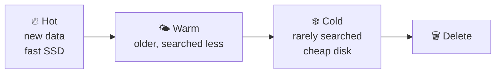

# 06. Production Best Practices

Everything that separates "it works on my VPS" from "it runs for years without waking anyone up".

---

## 🔒 1. Security (most important)

> [!CAUTION]
> Thousands of Elasticsearch clusters have leaked data because port **9200 was open to the internet** without authentication. Treat this as a top-priority rule.

| Do | Don't |
|----|-------|
| Keep Elasticsearch on a **private network / VPN** | Expose 9200 or 5601 publicly |
| Keep **security enabled** (it is on by default in 8+/9+) | Disable `xpack.security` "to make it easier" |
| TLS for HTTP **and** node-to-node traffic | Plain HTTP between servers |
| **API keys** for agents, **least-privilege roles** for people | Use the `elastic` superuser for apps |
| Kibana behind **Nginx + HTTPS** (+ SSO/VPN if available) | Share one admin login with everyone |
| Store secrets in a keystore / Vault | Passwords in Git or plain config files |
| Rotate API keys and passwords; set key expiry | Keys that live forever |
| Back up the **Kibana encryption keys** | Lose them (breaks alert rules/connectors) |

> [!WARNING]
> **Never commit passwords, API keys, or certificates to this GitHub repo.** Use placeholders like `YOUR_PASSWORD` in docs.

**Sensitive data in logs:** apps often log emails, tokens, card numbers. Mask or drop them **before** they are stored (Logstash `mutate`/`gsub`, ingest pipelines, or fix the app). Logs are not "private by default".

**Audit logging** and some advanced security features (SSO/SAML, field-level security...) depend on your subscription tier. Check what your license includes.

---

## 🗓️ 2. Retention with ILM (do this on day one)

Logs grow forever unless you stop them. **Index Lifecycle Management (ILM)** automates the life of data.



Simple policy (Kibana → Dev Tools): roll over daily or at 50 GB per shard, delete after 30 days.

```json
PUT _ilm/policy/logs-30d
{
  "policy": {
    "phases": {
      "hot": {
        "actions": {
          "rollover": { "max_primary_shard_size": "50gb", "max_age": "1d" }
        }
      },
      "delete": {
        "min_age": "30d",
        "actions": { "delete": {} }
      }
    }
  }
}
```

Attach it through an **index template** (or the data stream's lifecycle settings). Beats and Elastic Agent create data streams with default policies; adjust them with a custom component template rather than editing built-in ones.

**Decide retention by requirement, not guess:**

| Data | Typical retention |
|------|-------------------|
| App debug logs | 7-14 days |
| App / access logs | 30-90 days |
| Security / audit logs | 90-365 days (or legal requirement) |
| Metrics | 30-90 days (downsample older data) |

---

## 🧩 3. Shards and indices

| Rule of thumb | Why |
|---------------|-----|
| Aim for shards of **~10-50 GB** | Too small = overhead; too big = slow recovery |
| Keep shards per node reasonable (roughly **≤ 20 per GB of heap**) | Each shard costs memory |
| Use **rollover**, not "one index per day per tiny app" | Prevents **oversharding** |
| Set replicas to **1** in production (**0** on a single node) | HA vs yellow health |
| Define **index templates** *before* data arrives | Control field types |

**Mapping explosion:** if logs contain arbitrary keys (e.g., a field named after every user ID), Elasticsearch creates thousands of fields and slows down. Use fixed field names, `flattened` type for free-form objects, or limit with `index.mapping.total_fields.limit`.

**Use ECS field names** (Elastic Common Schema: `host.name`, `source.ip`, `http.response.status_code`, `log.level`). Dashboards, alerts, and prebuilt integrations all assume them.

---

## 💾 4. Backups (snapshots)

Replicas protect against a **node** failure, not against `DELETE`, ransomware, or a bad upgrade. Only **snapshots** do.

```json
PUT _snapshot/my_repo
{
  "type": "s3",
  "settings": { "bucket": "my-elk-snapshots", "base_path": "prod-logs" }
}

PUT _slm/policy/nightly
{
  "schedule": "0 30 1 * * ?",
  "name": "<nightly-{now/d}>",
  "repository": "my_repo",
  "config": { "indices": ["*"], "include_global_state": false },
  "retention": { "expire_after": "30d", "min_count": 5, "max_count": 50 }
}
```

(S3 shown; shared filesystem or other object storage also work, depending on version/setup.)

- Automate with **SLM** (Snapshot Lifecycle Management).
- **Test a restore** regularly. An untested backup is a hope, not a backup.
- Also back up: `elasticsearch.yml`, `kibana.yml`, Logstash pipelines, Beats configs, **certificates and keys**, Kibana saved objects (export, or keep dashboards in Git).

---

## 📏 5. Capacity and disk watermarks

Elasticsearch protects itself using disk watermarks (defaults):

| Disk used | What happens |
|-----------|--------------|
| **85%** (low) | No new shards are allocated to this node |
| **90%** (high) | Elasticsearch tries to move shards away |
| **95%** (flood) | Indices become **read-only**; ingestion fails |

**Alert at 70-75% disk**, not at 95%. Plan growth monthly.

Other sizing rules:

- Heap = **50% of RAM, max ~31 GB**. Never swap.
- Use **SSD/NVMe**, never network HDD, for hot data.
- Separate roles as you grow: dedicated **master** nodes, **hot/warm** data nodes, separate Kibana and Logstash hosts.
- OS limits are handled by the DEB package (file descriptors, `vm.max_map_count`); verify them anyway.

---

## 📈 6. Monitor the monitoring system

Who watches the watcher? Monitor the stack itself:

| What | How |
|------|-----|
| Cluster health, node heap/CPU/disk, shard counts, indexing rate | Kibana **Stack Monitoring** (Metricbeat/Agent collecting from ES, Kibana, Logstash) |
| "Is ingestion still working?" | Alert if **no new documents** from a host for N minutes |
| Cluster status not green | Alert (yellow → warn, red → page) |
| Disk > 75% | Alert |
| Logstash queue backing up | Monitor queue size / pipeline latency |

> [!TIP]
> Ideally send the monitoring data to a **separate** small cluster, so you still see problems when the main cluster is the thing that is broken.

---

## 🔁 7. Upgrades and change management

1. Read **breaking changes** and the upgrade assistant for your version.
2. **Back up first** (snapshot + configs).
3. Test the upgrade in a staging cluster.
4. Order: **Elasticsearch → Kibana → Logstash → Beats/Agents**. Never run Kibana, Logstash or Beats newer than Elasticsearch.
5. To move across majors (e.g., 8 → 9), first go to the **latest 8.19.x**, then follow the official path.
6. Do **rolling upgrades** on clusters (one node at a time, wait for green).
7. Pin package versions (`apt-mark hold elasticsearch kibana ...`) so `apt upgrade` never upgrades them by accident.

```bash
sudo apt-mark hold elasticsearch kibana logstash filebeat
```

---

## 🧰 8. Operations hygiene

| Practice | Details |
|----------|---------|
| **Infrastructure as Code** | Ansible/Terraform for servers, config in Git (without secrets) |
| **Dashboards as code** | Export saved objects (`.ndjson`) and keep in Git |
| **Naming conventions** | `environment`, `team`, `service` fields; consistent data stream names |
| **Spaces and RBAC** | Per-team Kibana spaces; developers see only their logs |
| **Runbooks** | "Cluster is red", "Disk full", "Agent stopped": written steps |
| **Log levels** | No `DEBUG` in production by default; log volume = cost |
| **Structured logging** | Apps write **JSON logs**; much easier than parsing text with grok |
| **Time sync** | NTP on every server, store everything in UTC |
| **Capacity review** | Monthly: ingest rate, disk growth, slow queries |

---

## ☁️ 9. Self-managed vs managed

| | Self-managed (this repo) | Elastic Cloud / managed |
|---|---|---|
| Control | Full | Limited by provider |
| Effort | You do upgrades, backups, scaling | Mostly handled for you |
| Cost | Servers + staff time | Subscription |
| Good for | Learning, strict data-location rules, cost control at scale | Small teams that want to focus on using logs, not running clusters |

Be honest about staff time: many teams find a managed service cheaper than the engineer-hours of running a cluster.

---

## ✅ Production readiness checklist

- [ ] Security on, TLS everywhere, no public 9200/5601
- [ ] 3+ nodes, odd number of masters, failure tested
- [ ] ILM retention defined and applied
- [ ] Index templates / ECS field names in place
- [ ] Snapshots scheduled **and a restore tested**
- [ ] API keys per agent group, least-privilege roles for humans
- [ ] Disk, health, and "no data" alerts configured
- [ ] Stack monitoring enabled
- [ ] Sensitive data masking decided
- [ ] Config and dashboards in Git (without secrets)
- [ ] Upgrade plan and version pinning
- [ ] Runbooks written

➡️ Next: [07. Pros, cons, and pitfalls](07-pros-cons-and-pitfalls.md)
