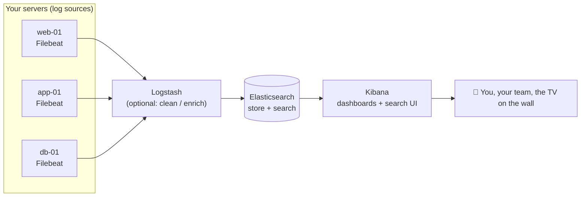

# 📊 ELK Stack & Kibana: From Zero to Production

> Centralized logging and monitoring for many servers, explained simply, set up the professional way.

This repo is a learning journal **and** a practical guide. Every concept starts with the simple idea, then adds the technical detail, then shows how it is done in a real production environment.

---

## 🗺️ Read in this order

| # | File | What you will learn | Level |
|---|------|--------------------|-------|
| 1 | [01-what-is-elk-stack.md](01-what-is-elk-stack.md) | What it is, why it exists, real use cases | 🟢 Beginner |
| 2 | [02-how-it-works.md](02-how-it-works.md) | Beats, Logstash, Elasticsearch, Kibana, inverted index, shards | 🟢 Beginner |
| 3 | [03-single-server-setup.md](03-single-server-setup.md) | Install everything on **one** Linux VPS (lab / small setup) | 🟡 Practical |
| 4 | [04-kibana-hands-on.md](04-kibana-hands-on.md) | Login, Data View, Discover, Dashboard, TV wall, alerts | 🟡 Practical |
| 5 | [05-multi-server-production-setup.md](05-multi-server-production-setup.md) | 5 servers shipping to a central stack, then a real 3-node cluster | 🔴 Production |
| 6 | [06-production-best-practices.md](06-production-best-practices.md) | Security, retention (ILM), backups, sizing, upgrades | 🔴 Production |
| 7 | [07-pros-cons-and-pitfalls.md](07-pros-cons-and-pitfalls.md) | Honest trade-offs, mistakes to avoid, alternatives | 🟠 Important |
| 8 | [08-troubleshooting-cheatsheet.md](08-troubleshooting-cheatsheet.md) | Commands and fixes for the problems you will hit | 🟠 Reference |

---

## 🧠 The whole idea in one picture



**One sentence:** every server ships its logs to one central place, where they are stored, made searchable in milliseconds, and shown as dashboards.

---

## ✅ Version note

- Commands in this repo follow the **8.x / 9.x** flow (security enabled by default, bundled Java, enrollment tokens).
- The latest major line is **9.x**. Replace `9.x` with `8.x` in the APT repo line if you must stay on 8.
- Always check the [official Elastic docs](https://www.elastic.co/docs) for your exact version before running anything in production.

## 📁 Repo layout

```text
elk-stack-and-kibana/
├── README.md
├── 01-what-is-elk-stack.md
├── 02-how-it-works.md
├── 03-single-server-setup.md
├── 04-kibana-hands-on.md
├── 05-multi-server-production-setup.md
├── 06-production-best-practices.md
├── 07-pros-cons-and-pitfalls.md
└── 08-troubleshooting-cheatsheet.md
```

## 🔤 Mini glossary

| Term | Plain meaning |
|------|---------------|
| **Log** | A line of text a program writes about what it did or what went wrong |
| **Event / Document** | One log line after it is turned into structured JSON |
| **Index / Data stream** | A "folder" of documents in Elasticsearch (like a table in a normal DB) |
| **Shard** | A slice of an index; shards are spread across nodes |
| **Node** | One running Elasticsearch process (usually one server) |
| **Cluster** | A group of nodes working as one system |
| **ECS** | Elastic Common Schema: standard field names (`host.name`, `log.level`) |
| **ILM** | Index Lifecycle Management: automatic move and delete of old data |
